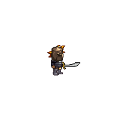
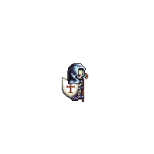
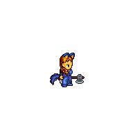
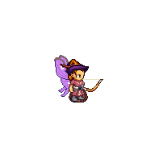
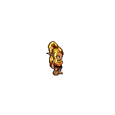

# Alkema

A character creator and multiplayer game demo built on [Liberated Pixel Cup](https://lpc.opengameart.org) sprites. It can create unlimited characters with deep aesthetic customization, equip weapons and armor, you can also test them in a live multiplayer environment.  

<em>Here are example characters generated by the API — each one unique</em>

  
  
  
   
  
  
  

## Character Creator

### Races and Body Types

30 playable races across 8 body types. Each race has its own forced features (elf ears, demon wings, furry tails), skin color palettes, and equipment restrictions.

**Races** — Human, Elf, Grey Elf, Orc, Goblin, Troll, Minotaur, Lizard, Dragonblood, Angel, Demon, Vampire, Skeleton, Zombie, Alien, and more — plus Fey variants (Pixie, Sylph, Dark) and Furry variants (Cat, Fox, Wolf, Bunny).

**Body types** — Male, Female, Muscular, Teen, Child, Pregnant, Skeleton, Zombie.

### Classes and Equipment

13 character classes, each with preferred weapons, armor, and equipment rules.

**Classes** — Warrior, Mage, Ranger, Thief, Pirate, Cleric, Noble, Guard, Merchant, Peasant, and age-based starter classes.

**Armor weights** — Heavy, Normal, Light, Formal, Topless, and Nude — each controlling which clothing and accessories are available.

### Aesthetic Customization

667 items across 106 categories. Mix and match:

- **91 hairstyles** with color variants
- **52 hats** with trims, buckles, and overlays
- **9 shields** with 49 heraldic patterns, paint, and trim layers
- **Cosmetics** — beards, mustaches, earrings, necklaces, hair extensions, scars, wounds
- **Race features** — wings, tails, horns, fins, furry ears
- **10 color palettes** that coordinate fabrics, accents, and metals across all equipped items

### Name Generation

Race-aware fantasy name generator produces unique names based on race and gender — humans get different naming conventions than orcs, fey, demons, or furry races.

## Weapons and Combat

### 36 Weapons

Swords, axes, polearms, daggers, bows, crossbows, slingshots, staves, wands, and more. Each weapon maps to the correct attack animation:

- **Swords and blades** → Slash (with oversized 128px or 192px attack frames)
- **Polearms and spears** → Thrust (oversized)
- **Bows, crossbows, slingshots** → Shoot (with projectile spawning)
- **Staves and wands** → Thrust or Slash depending on weapon

### Hit Detection

Server-side collision using oriented bounding boxes (OBB) computed per-frame from actual weapon sprite alpha data. Melee hits check point-in-OBB, ranged weapons spawn projectiles with their own collision. Hit cooldowns prevent multi-hits per attack swing.

### 15 Animations

Walk, Run, Idle, Combat Idle, Slash, Thrust, Spellcast, Shoot, Backslash, Halfslash, Jump, Sit, Emote, Hurt — all in 4 directions. Weapons with oversized sprites (128px, 192px) get larger attack frames automatically.

## Playing: Create Your Hero

Every session opens in a character creator built for one-thumb play on a phone:

- Pick a body (Male / Female), a race (Human, Elf, Furry, Fey) and a class (Warrior, Mage, Ranger, Thief, Cleric), or tap the **Random New Hero** die
- The die rolls a whole new hero every time (body, race, class, look and name), and so does every visit
- Random heroes get natural skin tones; fur, lavender and other race colors are yours to choose in **Customize look**, along with race kind (e.g. Cat, Fox, Wolf, Bunny), hair style, hair color and outfit colors
- A live preview walks your hero through the town and shows off only the moves their gear fully supports; rotate them to see every side
- Between walks, your hero spars a skeleton, goblin or orc with their class's real attacks: sword swings, arrows, magic bolts. Hits match what was struck (skeletons rattle, arrows throw splinters and a drifting feather, shields spark, spells scatter glints), and the winnings spill out as spinning coins that bounce and settle (just for show: sparring wins no real gold)
- Each class starts with a humble kit (e.g. a warrior gets legion armor, an arming sword and a wooden shield), revealed from a treasure chest (the classic LPC chest) when you press **Play**
- **Play** is always one tap away

Other races and classes are reserved for NPCs and enemies.

## Accounts and Saved Heroes

- Play straight away as a guest; a user icon in the corner (top right in the creator, at the end of the top bar in the world) opens your account menu
- Every hero you play is saved, with their look, name, quest progress, gold and gear: up to 10 heroes, listed under **My heroes**, where you can switch hero or delete one
- Guests' heroes are saved in the browser; create an account with your email and a password to keep them, and your guest heroes come with you
- Coming back shows the hero you last played, with **Random New Hero** still one tap away
- **About** at the bottom of the account menu links to the About us, Contact, Terms of service and Privacy policy pages

## Sound and Music

- Music that follows you: a heroic overture in the character creator, then a rotating playlist of town and countryside tracks in the world; lost in a dark forest the music turns to shadows, at sea a rollicking sailors' jig, in the snows of the far north (and Tumbledown) the songs of the north, and in a fight Wesnoth's battle music, crossfading as you go
- Every tap, pick and roll has a sound: dice rattle for **Random New Hero**, each class answers with its weapon (a sword drawn, a bow twang, a spell), pages turn in **Customize look**
- The creator's sparring bouts and the world's fights are fully voiced: whooshes, bone clacks, blocks, monster cries, a victory fanfare and coins
- The starter chest thuds down, creaks open and chimes for each item
- A speaker button cycles sound on, music off, or silent, and remembers your choice

## Battles

Fights are fought Ultima III style, on a battle map of their own:

- Bands of one to eight foes wait round Riverhold, each its leader standing watch: Goblin Pillagers (on wolves, with torches) just outside the gate and Orcish Grunts by the river below it; more goblins on the grass across the river to the west (Goblin Spearmen, Wolf Riders, Goblin Knights, Direwolf Riders); the undead up the river to the north and at the wood's edge to the south (Skeletons, Skeleton Riders, Bone Knights, Ghosts, Shadows, Nightgaunts). All are The Battle for Wesnoth's units, standing a head taller than you, with their own walk, idle, attack, hit and death animations
- Walk into it and you're on a portrait battle map, 11 by 14 tiles, of the country you met it in (grassland, forest or snow): a clearing in the woods with a trodden path, wildflowers, stones or mushrooms, laid out from the same Wesnoth grass, snow and trees as the world map, with battle music; a chime tells you when it's your party's turn again, a click as it passes to each of you, and you hear your footsteps and the foes' as they close in
- The foes start in three rows across the top of the field, you below: the row nearest you fills first (a lone foe stands in its middle), the rest take places behind at random
- It goes in turns: you take a step or an attack (a box marks whose turn it is; each step is a fresh press, so holding a direction never walks the whole party), then the foes take theirs, moving in together as a wave. Walk into a foe, or press attack beside one, to strike (with no one in reach the attack button is greyed out, and tells you to move closer); a bow or sling shoots down a row or column and stops in the first foe. Damage numbers fly, each foe's HP bar drains, they reel when hit, and fall with Wesnoth's death animation, then fade away. You walk among the trees, which thin when you're behind one
- The foes close in and strike, and their blows hurt (your red bar): riders on wolves and horses come two tiles a turn, ghosts and nightgaunts drift in diagonally, a shadow now and then vanishes and appears behind you, and a goblin badly hurt runs for the edge of the map (one that escapes leaves no gold). Fall, and you come to back in the world, the band still waiting; your hit points come back as you go
- You fight with a party of four: you, and three companions from Riverhold (a cleric, a mage and a ranger), standing by class: a warrior and a thief or ranger in front, a mage and a cleric a row behind (two of a class, and one takes a free place). You command each of them in turn; each has their own spells (the blue button opens whoever's turn it is), magic and hit points (a bar over each head). A cleric's Heal mends whoever is most hurt
- Fights at night are fought by moonlight: blue, but you can see every foe
- Walk off any side of the map to flee
- Beat them all and there's a moment's victory: the field dims, "Victory!" comes up with who fell (and, in a dungeon, what they carried), your party raises their weapons, and an orchestral fanfare plays
- Then you're back in the world, where a chest has dropped where they stood: gold for each foe and, likelier the bigger the band, a piece of gear any shop will buy. A new band is at the post a couple of minutes later

### A real-time fight, to try

By the sea mouth of Gloomwater Grotto wait four bands of demons (made with the character creator: a brute with a war axe, furies with tridents, a warlock who throws fire), and their fights are in real time, on the same cave battle map. Each is labelled with who comes with you: nearest the mouth, two demons you fight alone; then three with one companion, four with two, and six with all three:

- The demons start well back and stand still for a moment and a half as the fight opens, so you can find your hero; then they come on at a walk
- Move freely, and press attack whenever you like, even on the move: you swing at the demon nearest the way you face, stepping in to it if it's just out of reach; press again mid-swing and the next swing follows (a bow shoots straight at them)
- Your companions fight on their own: the cleric goes off and fights on her own, bringing lightning down with her blows now and then, and comes to heal whoever is worst hurt; the mage hangs back throwing fire, and now and then a great fireball; the ranger keeps their distance and shoots, now and then a burning arrow
- Spells: the blue button casts the spell you equipped (Equip's Magic tab), its icon on the button, and then it rests a few seconds, the button's ring filling as it comes back. Every spell has its own effect, sparks and sound; a melee one (a fighter's Mighty Swing, a cleric's Smite, a thief's Shadowstrike) swings bigger, sparks trailing the blade, and one you've had from the start shakes the screen a little as you cast it. Magic comes back slowly as you fight
- Every demon's blow is telegraphed: it stops and flashes red before it strikes, so you can step out of reach (and see "Dodged"); a warlock's fire flies where you stood. A brute's swing is slow but heavy, and a blow won't stop it
- No more than two wind up at you at once; the rest circle, waiting their turn
- Hits land with a moment's freeze, a flash and a knock back; struck, you can't be struck again for a moment
- Keep pushing against an edge to flee. Win, and it ends as the turn-based fights do, the demons gone till you next come down

## Spells

Every class has six spells (a fighter's and a thief's are battle skills), three ranks each, with painted icons:

- You learn spells, and their higher ranks, on the Upgrade page (below): your class's first spells you know from the start; every other is cast only once you've bought its upgrade. A spell's first level learns it, its 10th its second rank and its 25th its third, and each level makes it stronger
- Equip has two tabs, Gear and Magic. Magic shows every spell of your class with the four tiers it grows through, each with its own painted icon: ranks I, II and III at its upgrade's levels 1, 10 and 25, and its mastery at 50, when it's twice as strong again. Tiers you've reached are in full colour. Tap a tier to read what it does, its cost and how long it rests. Nothing is bought there, only equipped, one at a time: the round slot at the top holds the spell your blue button casts in a real-time fight, and tapping another spell you know puts it in the slot instead. Spells you haven't learned yet are locked
- Every spell works in the real-time fight: a fighter's **Battle Cry** (foes near you stagger), **Shield Wall** (blows hurt you half as much), **Cleave** (a whirling sweep at every foe around you), **Earthshaker** (the ground shakes, foes near you are struck and stagger) and **Berserk** (you hit harder, and so do they); a mage's **Frost Lance** (ice that slows, at its third rank freezes), **Lightning** (leaping foe to foe), **Arcane Missiles** (missiles that turn after their foe) and **Explosion** (a blast that strikes all beside the one it hits); a cleric's **Protect** (a ward on each of you that turns blows aside), **Holy Light** (light from above, twice as hard on the undead) and **Sanctuary** (heals all of you); a ranger's **Hunter's Mark** (blows at the marked land harder), **Entangle** (roots hold a foe), **Volley** (arrows at the nearest foes), **Wild Companion** (a spirit wolf of green light runs foe to foe) and **Swiftness** (quicker on your feet); a thief's **Poison Blade** (those cut sicken a while), **Smoke Bomb** (foes swing at nothing), **Evil Eye** (a curse: it misses, at the third rank it flees), **Throwing Knives** and **Vanish** (gone from sight; your first blow from hiding strikes two or three times as hard). In a turn-based fight, each class's first spells, the banes, Frost Lance, Explosion and Sanctuary can be cast; the rest only in a real-time fight
- A cleric also starts with **Smite**: her blow, and lightning from the sky on the foe she strikes (at higher ranks it leaps to a second foe, then strikes every foe beside her)
- Everyone starts with the first: a mage's **Fireball**, a cleric's **Heal**, a ranger's **Flaming Arrow**, a fighter's **Mighty Swing** and a thief's **Shadowstrike** (gone in a swirl of shadow, and back beside the nearest foe, striking). Skills strike two and a half to three and a half times as hard as a plain blow
- Mages and clerics also start with a bane, after Ultima III's Repond and Excuun: a mage's **Orcbane** sends fire down on every orc and goblin on the field, one after another, and a cleric's **Turn Undead** does the same to the undead; at their third rank most of those they touch simply fall
- In a fight, the blue button asks which to cast: your class's six, each at the highest rank you know, with what it costs; those still to learn are greyed. It's cast as your turn, with The Battle for Wesnoth's spell effects
- Spells spend your magic (the blue bar at the top), which comes back slowly out of a fight; battle skills rest a few turns between uses

## Upgrades

Where Stats was, the **Upgrade** page, after Clicker Heroes: a long list of upgrades to buy with the gold you find, each bought again and again, each level a little dearer than the last and a little stronger:

- Strength of Arm (attack), Vigour (hit points), Guard (defence), Focus (spell power and magic), Fortune (more gold from every chest, barrel and band) and Second Wind (hit points and magic come back faster); then the legends (Hero's Renown, Giant's Blood, Dragon's Heart, and on and on), each six times dearer than the last, each adding to everything. There's always another further down
- Every upgrade doubles what it gives at its 25th level, its 50th, its 100th, and every 100th after; a bar shows how far you are from the next
- Your spells are in the list too: buy one to learn it or rank it up, and its 10th level opens the next spell
- Buy one at a time, ten, twenty-five, or as many as your gold will run to. Three upgrades are shown at a time: the three cheapest to buy next, picked as you open the page and kept in place while you buy. Upgrades not open yet show what opens them
- Below the upgrades, the same list runs straight on into the **Goddesses**: fifty legendary heroes to buy, after Clicker Heroes' heroes, from Greek, Roman, Norse, Celtic, Egyptian, Mesopotamian, Slavic, Baltic and Finnish myth: Brigid of the Forge first, through Freya, Athena, the Morrígan, Bastet, Persephone, Hel, Tiamat and many more, to Gaia, Mother of All. Each is five times dearer than the last and gives far more (attack, hit points, defence, spell power, magic, gold found, faster recovery, and some a share of everything). Every one is in the list from the start, a dark shadow until the goddess before her reaches her 10th level (Brigid opens at Strength of Arm's 10th). Each is levelled up like any upgrade, doubling at her milestones, and drawn with the character creator's art
- The Stats tab beside it shows your level, hit points, magic and attributes, and how much of your attack, defence and spell your upgrades add. Upgrades are saved with your hero

## Multiplayer

Real-time multiplayer via Socket.io. Players share one overworld, built from LPC tiles, with The Battle for Wesnoth's painted grass, sand, snow, mountains and forests:

- A 512×512-tile map in the spirit of the classic Ultima games: a continent, one large island (a ragged coast of headlands and bays, its north under snow) and an arc of three small isles off the south-west coast (a long ridge, a crescent round a lagoon, a teardrop trailing an islet) in an animated ocean
- A great range of snow-capped peaks (The Battle for Wesnoth's hand-painted mountains, brought into the LPC palette: single peaks at the edges of a range, long snowy ridges in its heart, sandy ones by the desert) walls off the north, crossed by a single pass; more ranges run along the west coast, the south-east and the big island
- Beyond the range lies the far north, a broad cold country under Wesnoth's snow, its coast torn into sounds and fjords, snowbound fells west of a great bay cut deep into it, open to the northern ocean only by a winding strait; its woods are Wesnoth's snow-laden pines and bare winter trees, and it is all snow right up to the crest of the range, whose northern face is snowbound rock; a fishing village stands on the bay's frozen northern shore and a cave opens at the foot of the fells
- Two rivers that meet and run to the sea, opening into a broad estuary, crossed by three great stone bridges with arched spans and bannered pylons
- A long, winding arm of the continent (a narrow neck, a wooded headland, a hooked spur round a bay with a fishing village) broad where it leaves the mainland, reaches out toward the big island and ends across a narrow strait from the cursed city of Morvath: stand at its tip and the view pans across the water to the city, but only a ship will take you there
- Cities, villages, castles and dungeons shown as hand-drawn map icons in the LPC style (a walled city with paved streets and a cathedral spire, a castle round a flagstone courtyard, a village among its fields, a moat before the castle gate, a stone portal set into the foot of a Wesnoth mountain), each placed for a reason: every town on water (where the rivers meet, at the ends of the bridges, a port at the river mouth, harbours on the coast, a port for the desert, and where the pass road comes down to the great bay), villages on the strips of shore below the western mountains, and every castle where it guards something (the foot of the pass, the coast road through the south-eastern hills, the shore of the great bay by its strait, the island's ridge); caves sit in the mountain walls, and one on an isle just off the south-west shore, its mouth in sight across the channel from the beach. 8 cities, 5 villages, 4 castles and 8 dungeons in all
- The further a city or castle lies off the beaten track, the darker it is: those near the start are bright and bannered, then plain and grey, then grim with blood-red banners and few lights, and the most remote (beyond the northern range and on the great island) are black, broken ruins with a sickly light in their windows and a mist creeping through their streets
- Forests of The Battle for Wesnoth's painted trees, in the game's greens: broadleaf and pine woods, dense groves in their depths, great old trees, bushes, a touch of autumn and snowy woods in the far north, with pine woods thick at the foot of every range and climbing its lower slopes; you pass in front of and behind them, and a tree you stand behind thins so you can still see yourself
- Deep in a forest the light fails: the further in you go, the closer the dark comes, until you can see only a few steps around you
- A clear trail leads from every town, castle and cave on the map out through the woods to open country, but one: the cave in the northern fells lies behind the snowy forest
- One village lies hidden in a clearing at the heart of the great wood; it isn't on the minimap and its name appears only once you find it
- Walk up to a place and you're asked whether to enter it. Castle Dunmere, Castle Grimhold, Riverhold, the villages of Seacombe, Fernwick, Ashby, Tumbledown and Gull's Rest, and Gloomwater Grotto can be entered (the other places can't yet).
- Castle Grimhold, in the north under the great range, is Dunmere's dark twin: built hard against the mountains, which rise behind its walls, its stone dark and cold, its towers capped in crimson, its moat black. A black guard in iron plate and great helms keeps its bridge, gate and keep, and walks its courtyard, where the forge burns by a graveyard. Within, Lord Varek sits his throne among braziers and skulls, his jester in black and red at his feet, his necromancer in her study among the books and bones, his lady in her chambers; and down in the cells, demons from the high passes, horned and winged and chained, and skeletons that won't stay dead
- Barrels, crates and clay pots can be smashed, in every town, castle and dungeon (over a hundred of them, the grotto and Grimhold well stocked): swing at one (or shoot it) and it bursts into splinters with a crash, and sometimes there's gold or something worth selling inside. They're whole again next time you come.
- Riverhold is a market town in the manner of Ultima III where the two rivers meet
- Demons on the coast between Gloomwater Grotto and Castle Dunmere, in nine packs of three to six, fought right there on the world map in real time. Each pack mixes three kinds: furies darting in with tridents, brutes with war axes whose slow, heavy swing a blow won't stop (wait it out, then punish), and warlocks who hang back and throw fire, one or more in every pack. Halfway along stands a champion, a giant brute nearly as quick as a fury, with five demons about it, that leaves a chest when it falls. They hit hard enough that a careless fight can kill you. They're matched to your hero, however strong you've grown, and get tougher the nearer you get to Dunmere. Every demon you fell bursts into gold worth a good share of your next upgrade, more the further along the road, and more again for kills in quick succession (a combo, up to three times as much). Come within five tiles of one and its whole pack comes for you, each flashing red as it winds up to strike (step out of reach to dodge); you fight them just as in the real-time fights on battle maps: your attack turns you to the nearest and swings, a bow's arrow flies at it and strikes when it gets there, and the blue button casts the spell you've equipped, with all its effects, using magic that trickles back as you fight. Run far enough and it gives up and goes back to its post; fall, and you come to where you started
- Orcs on the coast the other way from the grotto, west along the shore: nine more packs, the same mix in The Battle for Wesnoth's orcs on foot. Goblin Spearmen dart in like the furies, Orcish Grunts swing swords, Orcish Warriors' greatswords come on whatever you hit them with, Orcish Archers hang back and shoot, and halfway an Orcish Warlord leads a pack of six and leaves a chest. They fight, pay and grow tougher just as the demons do
- New heroes start at Castle Dunmere's drawbridge. North of it, up between the castle and the sea and out across the sands west of Goldvale, thirty of Duelyst's Vanar wait in seven packs, the same mix again: Snowchasers and Ice Hornets dart in, Kindred Hunters strike between, Crystal Beetles and Water Bears come on whatever you hit them with, Water Elementals hang back and hurl water, and halfway a Great Bear leads a pack of six and leaves a chest. Drawn side-on with one sideways swing, they come round to your left or right, level with you, before they strike: step up or down out of their line as one winds up and it swings at nothing
- Gloomwater Grotto, a sea cave on the south-east coast, goes five levels down into the dark, lit only by torches, the smugglers' campfire, mushrooms glowing in the gloom and your own light, the sea's water running through all of it (deep water you can't cross, shallows you wade through). The Sea Mouth: a beach under the cliffs, the smugglers' dock and rowboat on the lagoon, a great waterfall, and an iron gate barred from the far side. The Smugglers' Warren: an underground river with a bridge and a ford, the smugglers' store, a chest on an island you can see long before you find the way to it, a hidden cache behind a waterfall, a ladder that brings you up behind that iron gate (lift the bar and you have a shortcut home), and a hole in the floor that drops you to the level below. The Floodgates: a great hall under water, galleries round it, and a floodgate to heave open, draining the hall and uncovering the stairs that were under it all along. The Drowned Shrine: the ruins of a sea temple, flooded colonnades, a font of clear water that heals you, and a great key in a moated sanctum barred from within, reached only by going round through the crypt. The Gloomwater: the great door the key opens, a causeway across a dark lake, and the Drowned One, fought on a cave battle map; beat it, take its hoard, and climb a rope straight up into the daylight. Chests hold gold and gear; what you open, drain and win stays done. Bands of ice and water creatures keep the first four levels (Duelyst's Vanar: Snowchasers, Ice Hornets, Crystal Beetles, Water Elementals, Kindred Hunters and Water Bears, recoloured to the brightness and saturation of the LPC characters, some also matched to the LPC palettes). Walk into one and you fight the whole band in a cavern of its own (rock walls and boulders, glowing mushroom groves, deep pools at its sides that close off some of the ways out: you can't wade in, nor can anything on foot, but what drifts floats over); they stand a head taller than the creatures outside, and swing side-on, so they come round to your corner before they strike. Beaten, a band's coins (and sometimes something worth selling) go straight into your pack, and it's gone till you next come down
- Castle Dunmere, in the south-east and in the manner of the castles of Ultima III to VI: cross the drawbridge over its moat and go in under the gatehouse, between round towers with blue cones, to a courtyard with a fountain, the chapel, the barracks, the stables and a kitchen garden, and the keep across its north side. The castle guard, in steel and mail under navy cloaks, stand at the bridge, the gate and the keep door and walk their beat round the courtyard, day and night, among the household and the castle's visitors. The keep is one great floor to explore, room opening into room: the entrance hall, the throne room where the Duke of Dunmere holds court on a red carpet between columns and banners, braziers burning either side of his throne and his jester, in a blue and purple cap with bells and a short cape, capering before it, the library, the feast hall laid for supper, the kitchen, the guardroom and, behind it under guard, the treasure room, piled with chests, and the armoury. A private stair goes up to the Duke's chambers, and another down from the armoury to the prison: a long corridor of barred cells, empty for now, and the jailer's room. Dunmere keeps out of the realm's quarrels, though its heart is with the good: its healer, in the chapel, mends your wounds and restores your magic for nothing
  - A cobbled square with a well and market stalls, ringed by buildings of every size: the Weaponsmith, the Armourer, the Healer's stone hall and the Apothecary (each with its name painted over the door and a hanging sign), The Ferryman's Rest inn, the stables, townhouses and thatched cottages
  - Built from LPC timber-framed walls, thatched and tiled roofs, doors, windows and town props, put together at whatever size each building needs
  - Walk up into a door and you're inside, with the door's creak and a fade the moment you step in, a card on the dark naming the place and the room you're entering while it loads (the rooms behind nearby doors are fetched ahead, so it's quick): every house and shop has a room (and the inn its upper floor) furnished from the LPC house interior set, by what they are for: swords and spear racks behind the weaponsmith's counter, helmets and breastplates at the armourer's, beds in the healer's hall, a still and shelves of books and bottles at the apothecary, a bar and a fireplace in the inn's taproom with a staircase up to a floor of guest beds, and in the homes (roomy enough to walk about in) a hearth, beds, a table by the fire, clocks and cupboards. Walk down out of the doorway to go back into the street. A barn's or a stable's big doors and a barred door don't open, and tell you so when you try them. Walk out through a town's or a castle's gate (or a dungeon's mouth) and you're asked if you'd leave, as you were asked to go in, and the gate shuts behind you as you go
  - Places off the main street to find: a back alley behind the smithy where a hooded stranger lurks (and a fence's den behind a barred door), a graveyard behind the healer's hall, a riverside walk, a pier out into the river, and a footbridge over the creek to a hermit's hut and a fisherwoman's shack on the outskirts
  - Townsfolk made by the character generator (ready-made, so everyone in the town, or in a room as you walk into it, is there the moment it loads): the shopkeepers behind their counters, drinkers at the inn, a patient at the healer's, people at home in their houses, a ferryman, a gravedigger and more keep their places and turn to face you as you come up; others wander the square and the streets
  - The town watch: twelve guards in one uniform (chainmail, a Norman helm, a spear and a tattered cloak; each with their own face) at the gate, round the square, at the healer's, the footbridge, the pier and the graveyard, three on patrol and one off duty at the inn
  - Story mode: walk into someone and the world waits while they speak, like a visual novel: their words, a line at a time, typed out in a box where the controls were, with their name, and above it, filling the screen, an anime-style painting of them where they stand, recoloured to match their sprite (AI-generated from their character data), lit for the time of day: by day in sunlight, after dark by moonlight and lamplight (the watch with their lanterns), or for anyone without one a crisp close-up of their own sprite. Space, Enter or a tap moves the story on; ◀ (or Backspace) goes back a line and LOG (or H) shows everything said so far; some ask you a question, answered Yes or No
  - Seacombe, on the west coast, is a farming village in a narrow combe between the fells and the sea, a brook running through it: vegetable beds fenced in rows, every crop at its own stage of growing (carrots, beets, onions, leeks, potatoes, pumpkins, melons and squash, a stand of corn taller than the scarecrow, a kitchen garden of peppers), and over the footbridge standing wheat, a field of ripe grain and one already cut with its bales drying; a barn with hay and troughs, the well and a stall of the week's crop, and a feed store shut up until the seed cart comes back from Riverhold. Its folk are out working the land: watering the beds, hoeing and digging, a lad carrying a basket between the plots, the village elder on his bench and the dairymaid resting on the hay bales; talk to any of them. Every one of its houses can be walked into
  - Fernwick, the village lost in the great wood north-east of Riverhold (it's on no map), is half as big again: houses along the lane, an orchard behind them with apples picked into crates and baskets, a woodcutter's yard, a pond on the green, fenced gardens, fields of wheat and grain, and a barn. Its folk are a shade darker than fair and every one of them black-haired; they water, hoe and dig, carry baskets through the orchard, and rest by the pond and on the hay bales. Every one of its houses can be walked into
  - Ashby, on the west coast, is half as big again too: the sea and a pier where a fisherman sits, four fields of grain and wheat along the cliff top, fenced gardens below the road, a barn and a square with a well, and an old beachcomber's hut on the shore. Its folk are pale and nearly all fair-haired, with a brunette or two from inland; they fish when they aren't farming. Every one of its houses can be walked into
  - Tumbledown, on the north shore of the great bay, lies under snow: a pine wood heavy with snow behind it, houses with snowed-up roofs and smoking chimneys, firewood stacked against every wall, a graveyard under the pines and the tumbled stones of its old watchtower on the point. The bay is frozen fast below the village, and its folk fish through holes in the ice with rods, split logs with axes, shovel the road clear and sit out by the Longhall, the alehouse where the whole village gathers. Every one of them is fair-skinned with white or flaxen hair. Every house in it can be walked into, and its smokehouse
  - Gull's Rest, a fishing harbour on the inner shore of the eastern hook, has two docks out into the bay with rowboats tied up alongside and more hauled out on the beach, a cobbled fish market selling herring, mackerel, cod, crabs, mussels and oysters off its stalls, a smokehouse, a boatwright's shed and the alehouse the village is named for. Its folk come from every coast, most of them fair, a few dark-skinned, with every colour of hair; they fish from the docks and the beach with rods, dig for bait, mend nets and tend their gardens. Every house in it can be walked into, and its smokehouse
  - Wren, an elf thief just inside Riverhold's gate, wants to get to Stonebridge but daren't travel the river road alone, and asks to come with you. She speaks: every line she says comes with a short voiced, animated clip of her saying it (AI-generated from her portrait, one set by day and one by night, from her day or night painting), played over her painting as the line appears, and again if you go back to it
  - The healers speak too: Riverhold's healer, and Maren in Castle Dunmere's chapel (who mends your wounds when you ask), each say their lines in voiced, animated clips, by day and by night
  - Some of Fernwick's and Seacombe's villagers speak as well: Tamsin, Mabel, Ruth and Agnes the baker in Fernwick, Nell, Meg, Ada and the crofter's wife in Seacombe each say their lines in a voiced, animated clip of her own, in a voice of her own; after dark, at home with the day's work put down, they say two different, flirtier lines
  - So do the women of Ashby (Ebba, Britt, Hilde and Wenna), Tumbledown (Liv, Kari, Tove and Brynja) and Gull's Rest (Tamsin, Femi, Gwen and Ysella): two flirty lines by day, two different ones after dark, with whatever they carried by day (a basket, a watering can, a fishing rod, a spade) put down
  - In Castle Grimhold's prison the three demons flirt with you through their bars, each in a voiced, animated clip and a voice of her own: two lines by day, and two different ones after dark
  - Gold and gear: every hero sets out with a purse of 100 gold. Riverhold's Weaponsmith (dagger, spear, oak staff, mace, hunting bow, iron sword, steel longsword, war axe, and a moonsteel blade), Armourer (mail coif, wooden shield, iron helm, leather armour, kite shield, chainmail, great helm, and plate armour) and Apothecary (ember, frost, mending and spark crystals, a dusk crystal, and the Heart of the Sun) sell, priced the way Ultima III did it: a few things a new hero can afford, some to save up for, and one far out of reach in every shop, and from behind their counters (a doorway behind each counter leads to a back room where the stock is kept in treasure chests; you can see one glinting through the doorway): talk to the keeper, hear them out, and say yes when they ask if you'd like to see their wares, and their shop opens, to buy or to sell back what you carry for about half its price, depending on your charisma. Equip shows your hero large on a lit stage (turn them round, tap them to see their weapon swing) with eight slots (weapon, shield, head, body, legs, feet, belt, crystal), each with a button to take off what's in it; tap a slot and what in your bag could go there is listed right under the slots, to wear with a tap. While a menu is open, the pad and the attack and spell buttons give it their room, leaving only the tab bar. All the clothing you set out in is your own gear, to take off or sell (ears, tails, wings and hoofs are part of your hero and stay): take it off (going without costs you 2 defence), or put on armour in its place; whatever you put on, your sprite is redrawn wearing it, for you and everyone near you. Items shows your bag. A two-handed weapon puts your shield away (and a shield a two-handed weapon), and you're told so. Every starting outfit works with every weapon the shops sell, so any hero can take up any weapon; a weapon with several moves skips any your clothes can't make. Hair is tucked under a helmet that covers the head. A crystal colours your spells, a ring and sparks of its colour that other players see too. Each piece shows what it adds to attack, defence or spell, against what you wear now. Gold, bag and gear are saved with your hero
  - Stats (a tab of the Upgrade page), in the style of Ultima III: level, hit points, magic points and experience; strength, dexterity, intelligence, wisdom and charisma, from your race (each race has its own strengths and how high each can grow) and your class; and the attack, defence and spell they come to with your gear on. Warriors and thieves have no magic points; mages cast from intelligence, clerics from wisdom, rangers from half their wisdom. Charisma gets you better prices: shopkeepers ask less and pay more for what you sell (and a hero with little charm pays a little more). Tap an attribute to see what it does
  - In a town or a room you see only the players who are there with you; walk out through the gate and you're back on the overworld
- A galleon waits at anchor off the port: walk into it to board and it sails like a ship, turning toward where you steer, gathering speed slowly, coasting, riding the swell (it yaws, surges and pitches, so it never runs ruler-straight), with a V of foam behind it. Sail the sea to reach the islands and steer into land to step ashore; the ship waits where you leave it. Other players see your ship
- Mountains, place icons and water block your way on foot; you can walk through the trees
- The world wraps around: walk off the east edge and you arrive at the west, and north joins south

Also in the world:

- Live character movement and animation sync
- Attack and spellcast broadcasting
- Equipment changes reflected in real time
- Player join/leave events
- Mobile-responsive layout with touch controls: the D-pad is a joystick too, its arrows a step their way and the thumb in its middle dragged any way you like, between the arrows too (on a diagonal your hero turns side-on); attack with another finger as you go. Your hero eases into a walk rather than leaping to full speed
- A round minimap showing the land around you, other players, and the way to your current quest
- Starter quests that teach the controls, then walk you round all five villages (Fernwick, hidden in the woods, then Seacombe, Ashby, snowy Tumbledown and the harbour of Gull's Rest), then to a castle and a dungeon's mouth; every new hero starts them fresh
- A short cooldown on the ability button, shown as a filling gold ring
- Warm golden-hour light over the world, matching the character creator's stage, where motes drift in the light and a spotlight falls on your hero while you customize
- Day and night: the sun goes round once every 24 minutes (an hour a minute), the same for every player. Dawn comes up rose, dusk falls gold and the night is moonlit blue; everything in the world is lit by real 2D lights, so after dark the windows of every house glow, torches burn by the inn and alehouse doors, the towns on the map shine in the distance, and you carry a little light of your own. Indoors, hearths and stoves crackle with animated fire and lanterns and candles throw pools of warm light. The townsfolk keep the hours: at dusk the farmers, fishers and woodcutters down tools and head in at their own doors a few at a time, and at night they're at home round the hearth or crowded into the tavern (Riverhold's inn, Tumbledown's longhall, the alehouse at Gull's Rest), coming out again at first light; the town watch keep their posts all night, the watchmen walking their beat with a lantern
- Campfires burn on Tumbledown's frozen shore and Gull's Rest's beach, Sharm's animated LPC fire
- Light snow falls across the far north and in Tumbledown, drifting past as you walk through it

## Art Attribution

Every LPC sprite asset is tracked to its original artist and license. The API generates per-character credit files listing all contributing artists, their licenses (CC-BY-SA, CC-BY, CC0, OGA-BY, GPL), and source URLs — so attribution stays accurate no matter which items a character uses. 71 artists credited across the current asset library.

## API

A REST API powers all character generation. Full interactive docs at `/docs` (Swagger UI).

| Endpoint | Description |
|----------|-------------|
| `POST /generate-sprite` | Generate a character spritesheet PNG from item selections |
| `GET /random-character` | Generate a random character with race/class/armor rules; supports starter kits, seeds and look overrides |
| `GET /random-character/sprite` | Random character as a PNG |
| `POST /generate-gif` | Animated GIF promo image from selections |
| `GET /random-character/gif` | Random character as an animated GIF |
| `POST /character-credits` | Per-character artist attribution file |
| `GET /items`, `GET /items/{category}` | Browse the item database |
| `POST /available-options` | Items compatible with current selections |
| `GET /classes`, `GET /rules` | Character class and generation rule docs |
| `GET /player-options` | Races, classes and looks available to players, with color swatches |
| `GET /random-name` | A race-appropriate fantasy name |
| `GET /weapon-hitboxes` | Weapon hitbox data for all melee weapons |
| `POST /auth/register`, `POST /auth/login`, `POST /auth/logout`, `GET /auth/me` | Player accounts (email and password; session cookie) |
| `GET /auth/providers` | Which sign-in options are available |
| `GET /saves`, `PUT /saves/{id}`, `DELETE /saves/{id}`, `POST /saves/import` | A signed-in player's saved heroes (up to 10) |

## Tech Stack

- **FastAPI** + **Pillow** — Sprite composition and REST API
- **PostgreSQL** + **SQLAlchemy** — Item database with tag/layer relationships
- **MongoDB** — Game state and player persistence
- **Phaser 3** — Browser game engine
- **Socket.io** — Real-time multiplayer
- **Docker Compose** — Full stack orchestration with auto-deploy
- **Vite** — Client build tool

## Credits

Built on assets from the [Liberated Pixel Cup](https://lpc.opengameart.org) and the [Universal LPC Spritesheet Character Generator](https://github.com/sanderfrenken/Universal-LPC-Spritesheet-Character-Generator). See [CREDITS.txt](CREDITS.txt) for the full list of contributing artists and their licenses. Riverhold's buildings are bluecarrot16's LPC thatched-roof cottage, roofs, windows and doors, with LPC terrains, bricks and medieval decorations by many hands; its rooms are furnished from Reemax's (Tuomo Untinen) LPC house interior set, after Sharm's LPC base tiles. The villages' crops are bluecarrot16's LPC Crops (with Daniel Eddeland, Joshua Taylor and Jetrel), its sacks, baskets and produce from the LPC Containers and Foods. The world map's grass, beaches, desert, snow, mountains and forests are the painted terrain of [The Battle for Wesnoth](https://www.wesnoth.org) (GPL v2+), by its terrain artists, chiefly Hogne Håskjold, with desert mountains by doofus-01, recoloured to the game's palette. Spell icons are J. W. Bjerk's Painterly Spell Icons (CC-BY 3.0); spell effects are Wesnoth's. The foes you fight are Wesnoth's units (orcs, goblins and the undead), by its unit artists, on battle maps strewn with Wesnoth's flowers, stones, mushrooms and dirt. Music by Matthew Pablo, cynicmusic, RandomMind, Scott Buckley and The Battle for Wesnoth's composers (Tyler Johnson, Gianmarco Leone, Timothy Pinkham, Mattias Westlund, Stephen Rozanc); sound effects by Kenney, artisticdude, rubberduck, Ogrebane and Vehicle (see CREDITS.txt).

## License

See [LICENSE](LICENSE) for details.
